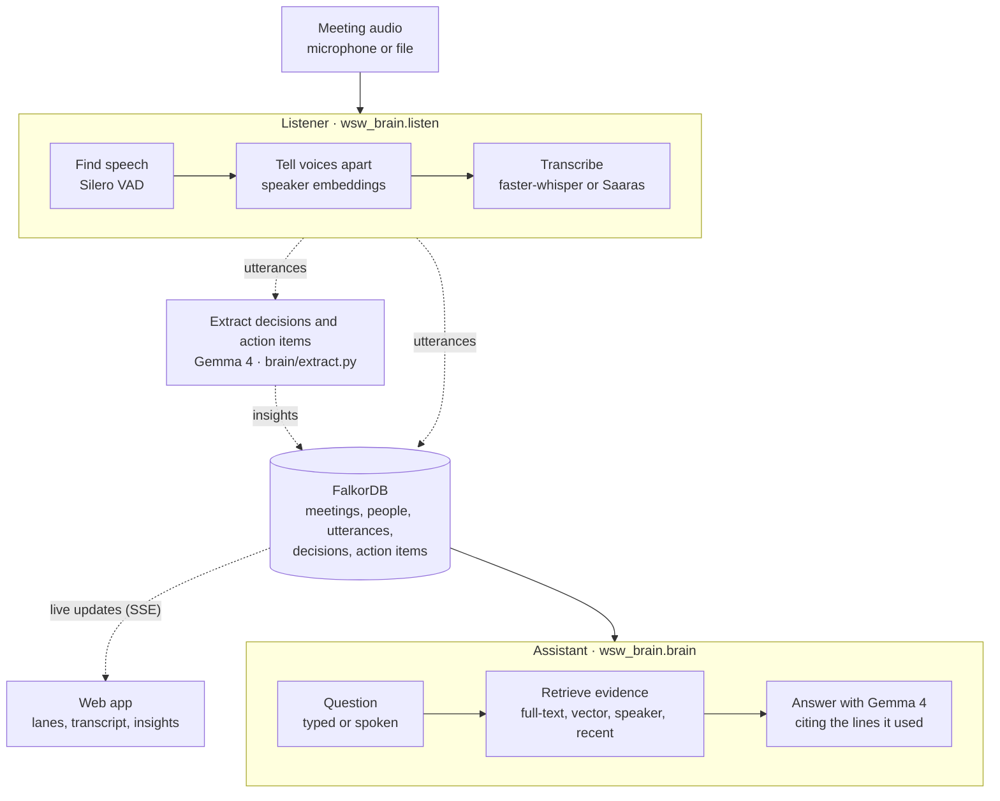
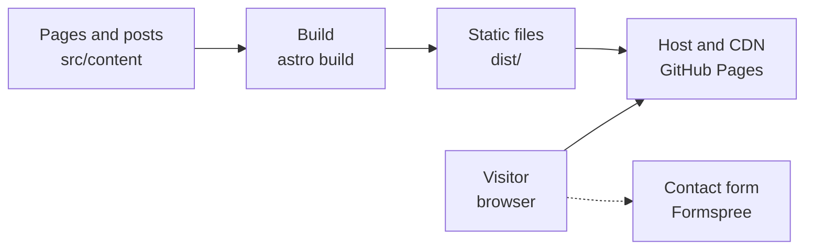
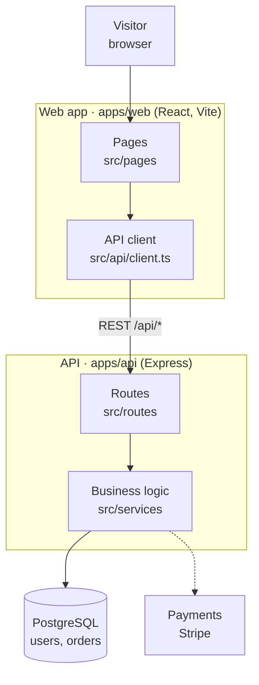
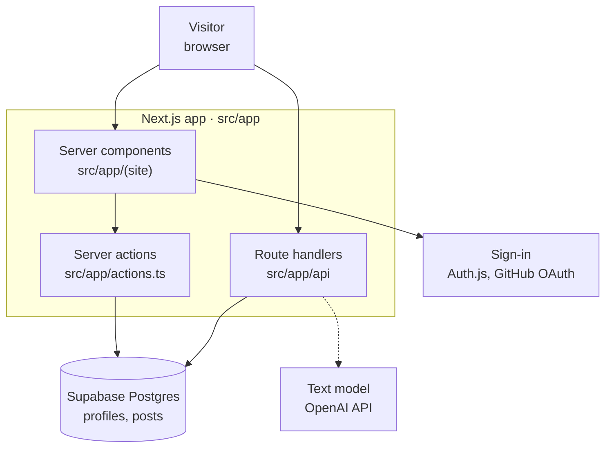
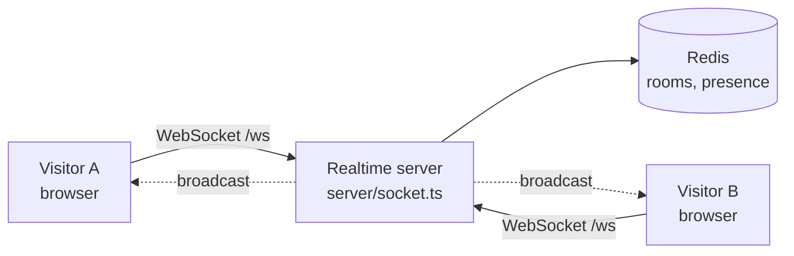
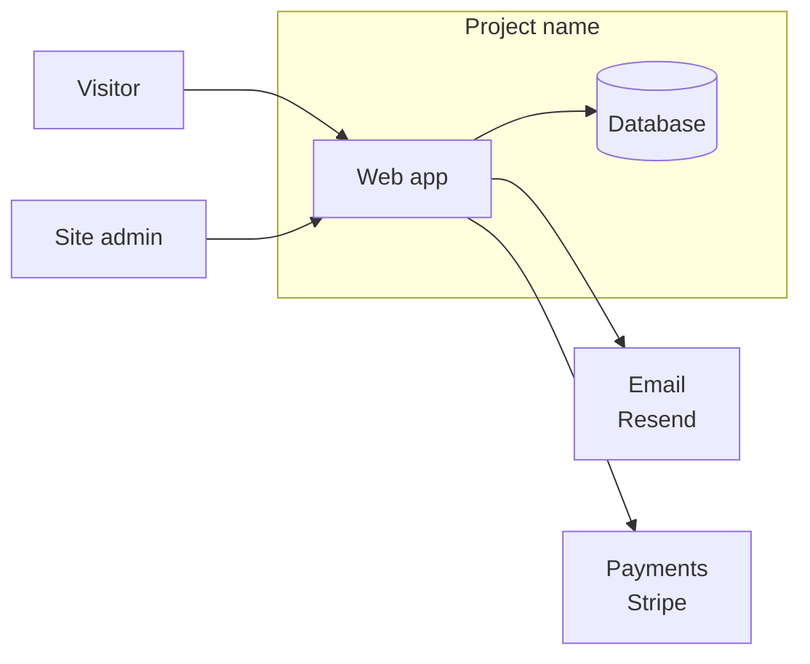
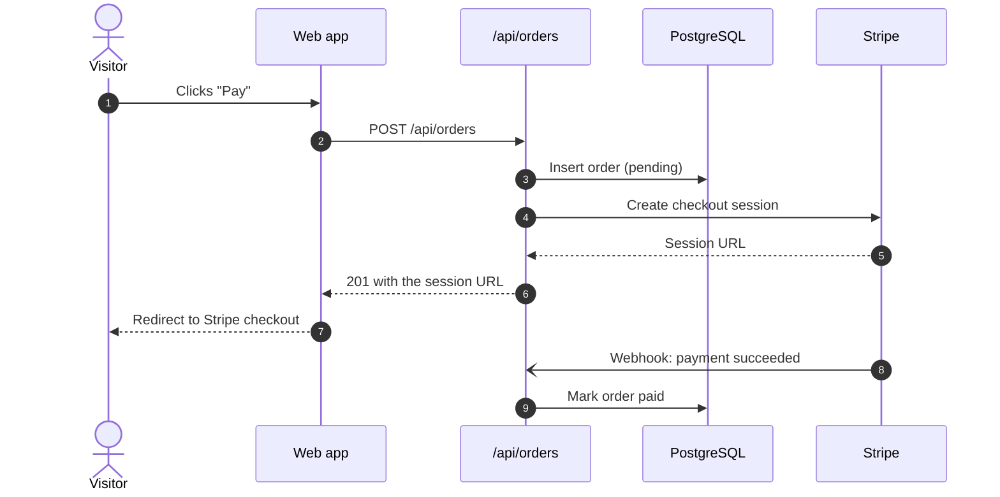
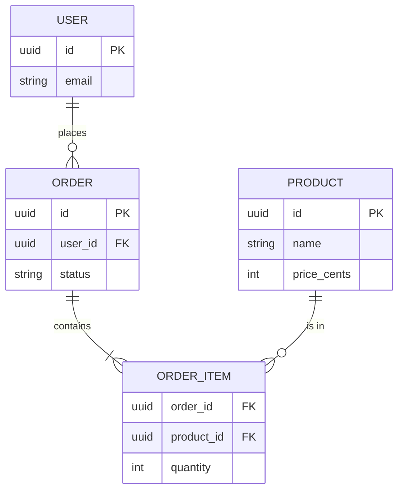
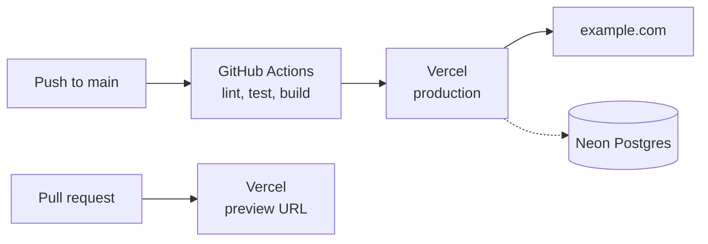
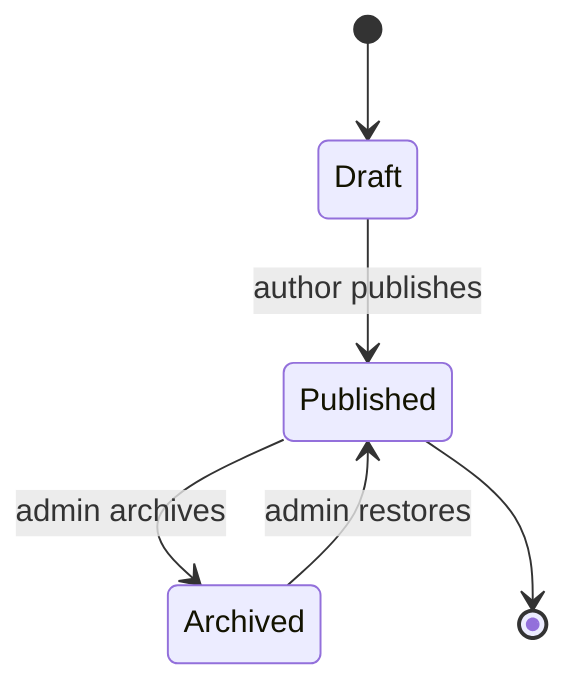

# Architecture diagrams for websites

Mermaid patterns to copy into a README or `docs/ARCHITECTURE.md`. GitHub renders a ```` ```mermaid ```` block as a diagram, so the diagram lives in the Markdown and changes in the same pull request as the code.

Pick the pattern closest to the project, then rename every node to a real folder, file, service or table. Delete nodes the project does not have.

## The reference: On Record

The "How it works" diagram from [On Record](https://github.com/PDGamerSG/On-Record). Each node says what happens in plain words, then names the real component. Subgraphs group the parts of one package. Dashed arrows mark background flows.



## Static site

A site built to HTML at deploy time, with no server of its own. Astro, Hugo, Jekyll, Eleventy, or Vite with no API.



## Single-page app with its own API

A React, Vue or Svelte front end that calls a separate server.



## Full-stack framework

Next.js, Nuxt, SvelteKit or Remix, where pages and API routes live in one app.



## Realtime

Live updates over WebSockets or Server-Sent Events.



## Context (C4 level 1)

Who uses the site and which outside services it calls. Put it near the top of `docs/ARCHITECTURE.md`.



## A request, step by step



## Data model



## Deployment



## State of one record



## Rules that keep GitHub rendering

| Rule | Why |
| --- | --- |
| Quote every label: `api["API routes<br/>src/app/api"]` | Parentheses, slashes, colons and `@` in an unquoted label stop the parser |
| Use `<br/>` for a line break inside a label | A real newline inside a label is a syntax error |
| Use short plain ids: `web`, `api`, `db` | Ids with spaces fail, and the id `end` is reserved |
| `[( )]` draws a database cylinder: `db[("PostgreSQL")]` | Readers spot the data store at a glance |
| Solid arrows for requests, dashed `-.->` for background work and unwired parts | The dashed line tells the reader the flow is not a direct call |
| Label an arrow with its protocol when it matters: `-- "REST /api/*" -->` | The reader sees how the parts talk |
| `direction LR` inside a subgraph lays out its steps in a row | A pipeline reads left to right while the overall diagram flows top to bottom |
| Keep a diagram under about 15 nodes | Larger diagrams shrink to unreadable text on GitHub. Split them |
| No `click` lines and no custom `style` colours | `click` does nothing on GitHub, and fixed colours clash with dark mode |

To find a syntax error before you push, paste the block into [mermaid.live](https://mermaid.live), or render the whole file:

```bash
npx -y @mermaid-js/mermaid-cli -i README.md -o /tmp/readme-check.md
```
