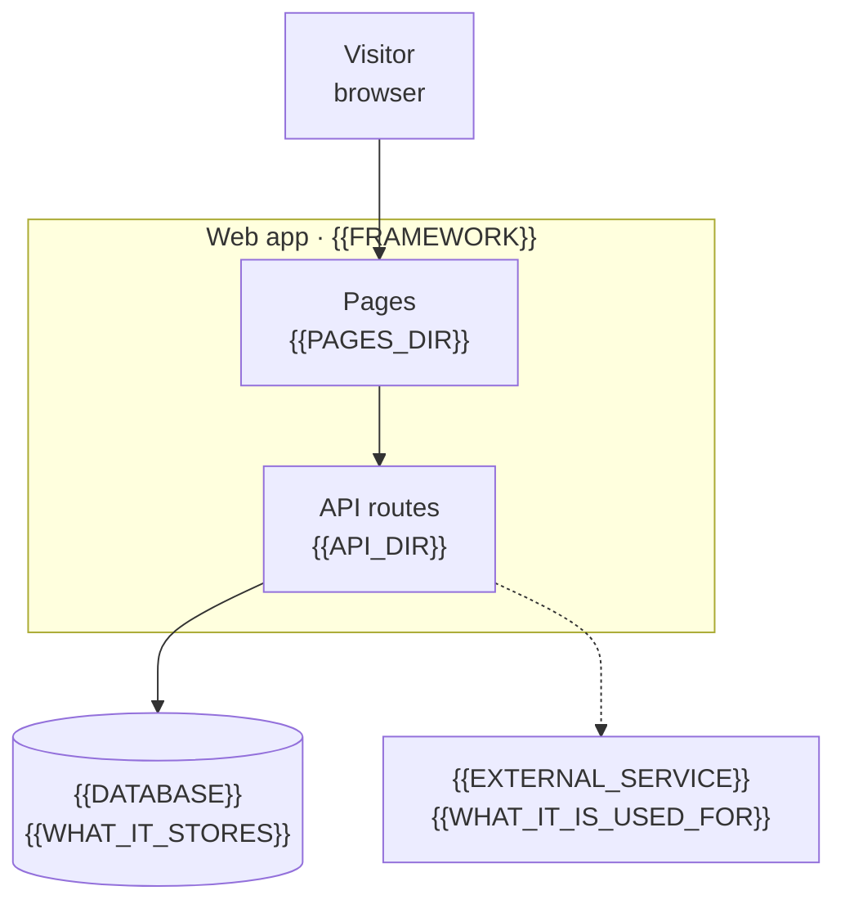

# {{PROJECT_NAME}}

**Team {{TEAM_NAME}}**

- {{MEMBER_1}}
- {{MEMBER_2}}
- {{MEMBER_3}}

Live link: [{{LIVE_DOMAIN}}]({{LIVE_URL}})

<p align="center">
  
</p>

{{WHAT_IT_DOES: one paragraph. What the site does and who it is for. Plain words, no technology names.}}

{{WHAT_IS_INCLUDED: one paragraph. What the repository contains, part by part.}}

## Features

| Feature | What it does |
| --- | --- |
| {{FEATURE}} | {{ONE_SENTENCE_ABOUT_WHAT_A_VISITOR_GETS}} |

## How it works

{{ONE_SENTENCE: what happens from the moment a visitor opens the site.}}



{{WALKTHROUGH: one paragraph that follows the arrows in the diagram.}} [The architecture notes](docs/ARCHITECTURE.md) have the component diagram, the request flow and the data model.

## Screenshots

{{CAPTURE_NOTE: where they were taken and how, e.g. "Taken from the live site at 1440 × 900 in Chrome, light theme."}}

<p align="center">
  
  <br><em>{{CAPTION}}</em>
</p>

<table>
  <tr>
    <td width="50%"></td>
    <td width="50%"></td>
  </tr>
  <tr>
    <td><em>{{CAPTION}}</em></td>
    <td><em>{{CAPTION}}</em></td>
  </tr>
</table>

## Tech stack

| Component | Purpose | License |
| --- | --- | --- |
| {{COMPONENT}} | {{PURPOSE}} | {{LICENSE}} |

## Quick start

You need {{PREREQUISITES_WITH_VERSIONS}}. If a step fails, see [the troubleshooting guide](docs/TROUBLESHOOTING.md).

```bash
git clone https://github.com/{{OWNER}}/{{REPO}}.git
cd {{REPO}}
cp .env.example .env    # then fill in the values listed in docs/CONFIGURATION.md
{{INSTALL_COMMAND}}
{{DEV_COMMAND}}         # http://localhost:{{PORT}}
```

### Checks

```bash
{{LINT_COMMAND}}
{{TEST_COMMAND}}
{{BUILD_COMMAND}}
```

{{CI_NOTE: which of these CI runs, and from which workflow file. Say so if there is no CI.}}

### Deploy

{{DEPLOY_NOTE: where the live site is hosted, which branch deploys, and which settings the host needs.}}

## Repository map

| Path | What it holds |
| --- | --- |
| `{{PATH}}` | {{WHAT_IT_HOLDS}} |

## Documentation

- [Architecture](docs/ARCHITECTURE.md): how the parts fit together, the request flow and the data model.
- [Configuration](docs/CONFIGURATION.md): every environment variable, its default, and what reads it.
- [User guide](docs/user-guide.md): each page of the site and what it does.
- [Troubleshooting](docs/TROUBLESHOOTING.md): setup and deploy problems and their fixes.

## Known limits

- {{LIMIT}}
- {{LIMIT}}

## License

{{LICENSE_NAME}}. See [LICENSE](LICENSE) and the [third-party notices](THIRD_PARTY_NOTICES.md).
