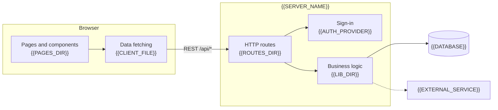
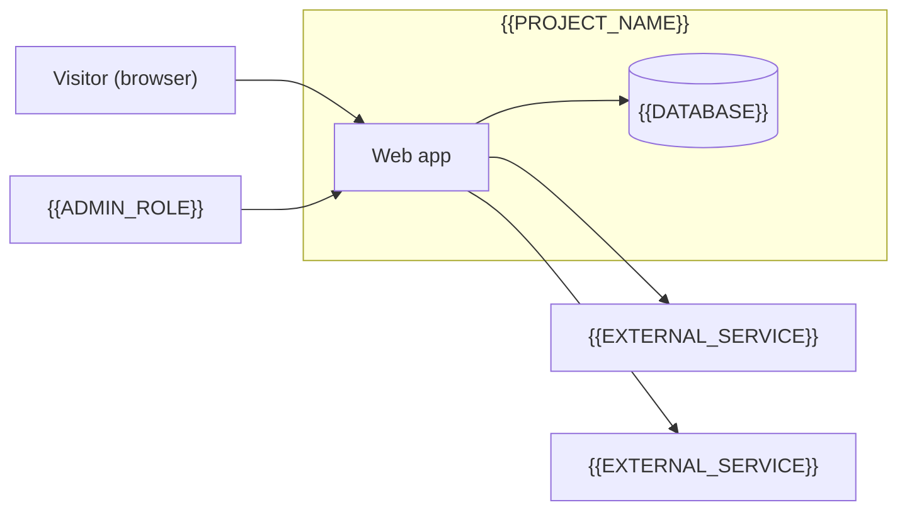
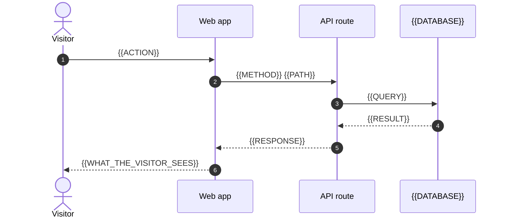
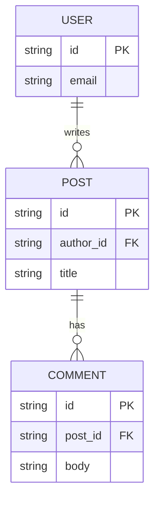
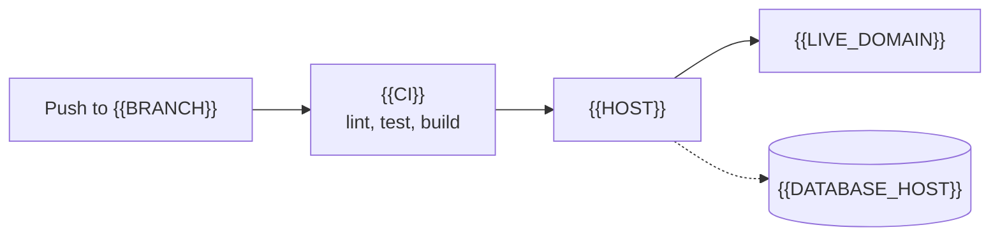

# Architecture

How the parts of {{PROJECT_NAME}} fit together, for anyone reading the code for the first time. The [README](../README.md) shows how to run it, [CONFIGURATION.md](CONFIGURATION.md) lists every setting, and [TROUBLESHOOTING.md](TROUBLESHOOTING.md) helps with setup problems.

Each part below has a status: **Implemented** (works end to end), **Partial** (code exists but is not wired up) or **Planned** (only the docs or the UI expect it). Every diagram is followed by the files it was drawn from.

## The parts

<!-- kit: one node per real folder, service or process. Delete nodes the project does not have. -->

Sources: `{{FILE}}`, `{{FILE}}`.

- **`{{DIR}}`**: {{WHAT_IT_IS_AND_ITS_STACK}}
- **`{{DIR}}`**: {{WHAT_IT_IS_AND_ITS_STACK}}
- **{{DATABASE}}**: {{WHAT_IT_STORES_AND_HOW_TO_RUN_IT}}

| Folder | What it holds | Status |
| --- | --- | --- |
| `{{DIR}}` | {{WHAT_IT_HOLDS}} | Implemented |

## Context

Who uses the site and which outside services it talks to.

*C4 level 1, system context: {{PROJECT_NAME}} and the outside services it calls.*

| Outside service | Data sent | When |
| --- | --- | --- |
| {{SERVICE}} | {{DATA}} | {{TRIGGER, with file:line}} |

## Main request

What happens when a visitor {{MAIN_ACTION}}.

Sources: `{{FILE}}`.

## Data model

<!-- kit: one entity per table or collection. Skip this section if the site stores no data. -->

Sources: `{{SCHEMA_FILE}}`.

| Entity | Stored in | What it holds |
| --- | --- | --- |
| {{ENTITY}} | {{TABLE_OR_COLLECTION}} | {{FIELDS}} |

## Deployment

Sources: `{{DEPLOY_CONFIG_FILE}}`. If the repository does not record how the site is deployed, say so here instead of guessing.

## What is not built yet

| Part | Status | Evidence |
| --- | --- | --- |
| {{PART}} | Partial | `{{FILE}}` |
