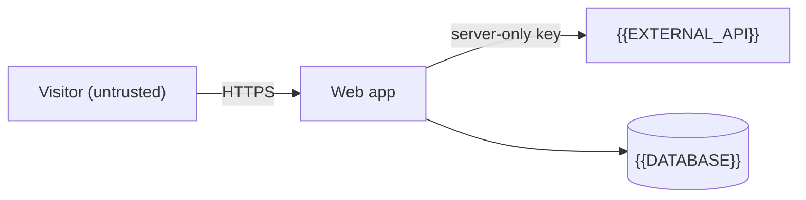

# Threat model

What data {{PROJECT_NAME}} handles, where it goes, and how it is protected. Write this when the site has accounts, stores personal data, takes payments or calls paid APIs.

## Data the site handles

| Data | Stored in | Sent to | Who can read it |
| --- | --- | --- | --- |
| {{DATA}} | {{STORE}} | {{SERVICE}} | {{ROLES}} |

## Trust boundaries

## Risks and mitigations

| Risk | Where | Mitigation | Status |
| --- | --- | --- | --- |
| {{RISK, e.g. "API key exposed to the browser"}} | `{{FILE}}` | {{MITIGATION}} | {{IMPLEMENTED_OR_OPEN}} |

## Keys and secrets

{{WHERE_KEYS_LIVE_AND_HOW_TO_ROTATE_THEM}}
