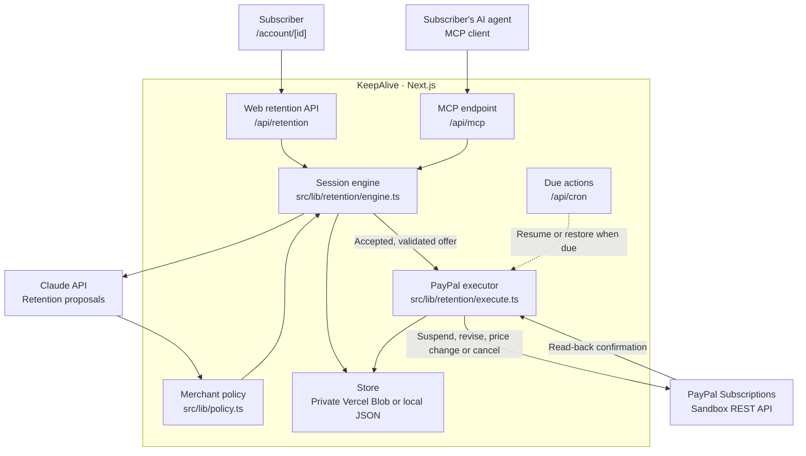
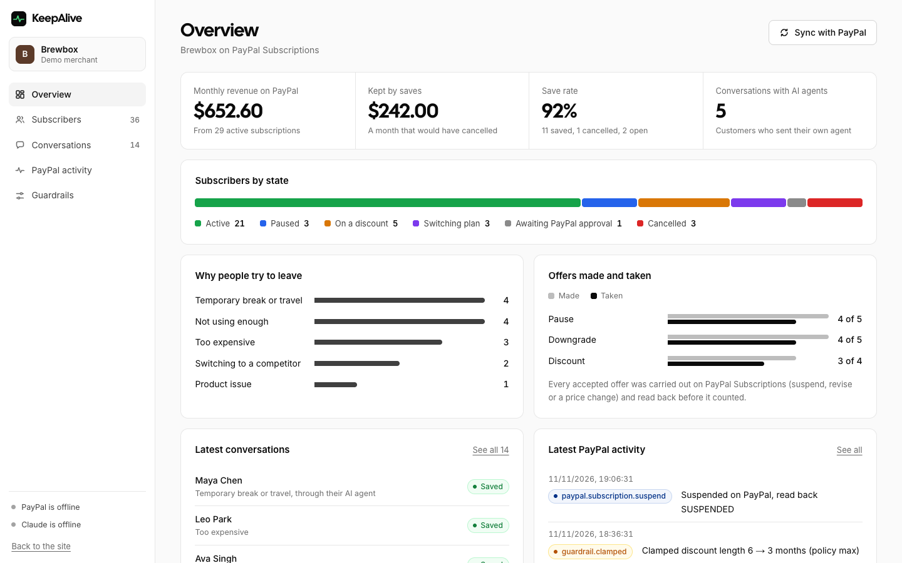
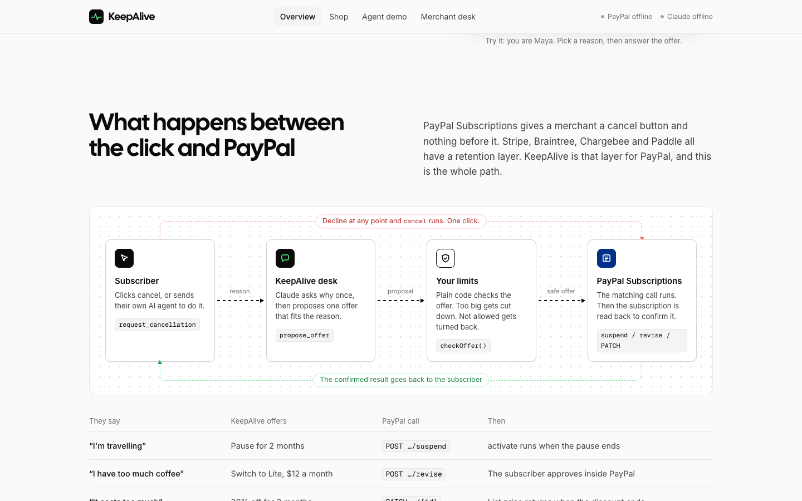
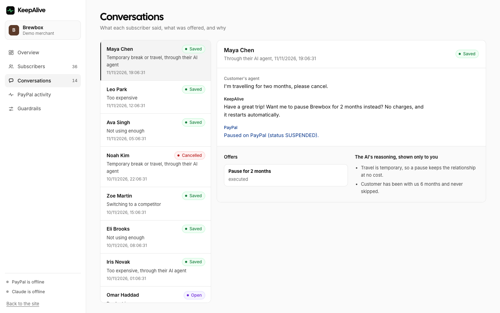

# KeepAlive

**Team members**

- Pallab Das
- Hydra Of Malice

Live link: [keepalive.pallabdas.me](https://keepalive.pallabdas.me/)

<p align="center">
  
</p>

KeepAlive helps merchants who bill through PayPal Subscriptions respond when a subscriber, or their AI agent, asks to cancel. It learns why they are leaving, proposes a pause, a downgrade or a temporary discount within the merchant's limits, and applies accepted offers through PayPal. Cancellation stays available throughout the conversation.

Built for the [PayPal AI Hackathon](https://paypalaihackathon.devpost.com/) in November 2026. This repository contains the Next.js app, the retention and consumer agents, the PayPal integration, an MCP endpoint, a merchant dashboard and tests. Brewbox, the coffee subscription used in the demo, is fictional. Payments use the PayPal sandbox.

## Try it

The hosted demo needs no account or key. Open [keepalive.pallabdas.me/shop](https://keepalive.pallabdas.me/shop), enter any name and email, and pick a checkout:

- **Try the instant demo (no PayPal login):** approve on a simulated PayPal step on the site. Pausing, discounts, plan changes and cancelling then run on KeepAlive's in-app PayPal simulator, and each call is logged as simulated.
- **Subscribe with PayPal:** the real PayPal sandbox. Log in with a PayPal **sandbox Personal** test account (developer.paypal.com → Testing Tools → Sandbox Accounts). Real PayPal logins don't work there, and no real money moves.

Then select **Manage my subscription → Cancel subscription** and say why you are leaving. The AI proposes one offer within the merchant's limits; accept it or cancel in one click. Open [/agent](https://keepalive.pallabdas.me/agent) to watch two AI agents negotiate, and [/merchant](https://keepalive.pallabdas.me/merchant) for the merchant desk and the PayPal activity log.

## Features

| Feature | What it does |
| --- | --- |
| Retention conversations | Claude responds to the reason for leaving and proposes a pause, a cheaper plan or a temporary discount. Cancelling stays one click away throughout, including while a subscription is paused. |
| Merchant limits | Deterministic checks approve, clamp or reject proposals against discount, duration, tenure, offer-count and monthly budget limits. |
| PayPal execution | Accepted offers suspend billing, revise the plan with buyer approval or override the subscription price. Results are read back from PayPal. |
| Agent-to-agent negotiation | A subscriber's agent uses MCP to request cancellation, discuss offers and relay decisions through the same retention engine. The `/agent` demo asks the human before acting. |
| Merchant dashboard | A five-page desk at `/merchant`: an overview with retained monthly revenue, save rate, subscribers by state, cancellation reasons and offer uptake, then pages for subscribers, conversations, PayPal activity and guardrail settings. |
| Scheduled follow-up | Due actions resume paused subscriptions and restore expired discounts. Vercel runs the scheduled job daily; relevant page visits also check due actions. |
| Interactive walkthrough | The landing page has a sample cancellation you answer yourself, a diagram of the path from the click to PayPal, a sequence diagram of an agent-to-agent cancellation, and a playground that runs the actual `checkOffer()` logic in the browser without backend calls. |
| Two checkout paths | The PayPal sandbox checkout, or an instant demo whose subscriptions (`I-DEMO…`) are approved on a simulated PayPal step and then served by an in-app simulator of the Subscriptions API with PayPal's state rules. |

## How it works

The web flow and external agents share one retention engine; merchant policy checks every proposed offer before the executor can change a PayPal subscription.



Claude supplies the reply and proposal. The engine checks the proposal against policy, records the conversation, and waits for a decision. Accepted offers go through the executor; plan revisions return a PayPal approval link for the buyer. The app also verifies incoming PayPal webhook signatures before synchronizing subscription events. See [the architecture](docs/ARCHITECTURE.md) for the modules and data model.

### PayPal integration

| Capability | Implementation |
| --- | --- |
| Create the demo product and billing plans | `ensureCatalog` in [subscriptions.ts](src/lib/paypal/subscriptions.ts) |
| Create a subscription and obtain buyer approval | `createSubscription`, exposed through `/shop` |
| Pause and resume | `suspendSubscription`, `activateSubscription` |
| Change to a cheaper plan | `reviseSubscription`, with PayPal buyer re-consent |
| Apply and restore a price override | `setSubscriptionPrice`; read-back requests include plan pricing |
| Cancel | `cancelSubscription`, followed by status confirmation |
| Verify and process webhooks | [PayPal webhook route](src/app/api/webhooks/paypal/route.ts) |

### Connect an external agent

For a locally running app:

```bash
npx -y mcp-remote http://localhost:3000/api/mcp
```

The hosted endpoint is [keepalive.pallabdas.me/api/mcp](https://keepalive.pallabdas.me/api/mcp). Tools cover subscription lookup, cancellation requests, messages, accepting and declining offers, direct cancellation and session lookup. A request starts with the subscription ID and the email on file. A plan change still needs the human's approval inside PayPal.

## Screenshots

Captured from a local production build in headless Chrome on 12 November 2026 at a 1440 × 900 viewport, in the light theme, with reduced motion turned on. PayPal and Claude were not configured for that build, so the pages show an offline notice; these images do not demonstrate a completed payment. The dashboard and conversation images use seeded demo subscribers, not live PayPal data.

<p align="center">
  
</p>

*The merchant desk overview, with a sidebar to the subscriber, conversation, PayPal activity and guardrail pages.*

<table>
  <tr>
    <td width="50%"></td>
    <td width="50%"></td>
  </tr>
  <tr>
    <td>The path from the cancel click to PayPal and back.</td>
    <td>The playground evaluates proposed offers against merchant limits.</td>
  </tr>
  <tr>
    <td></td>
    <td></td>
  </tr>
  <tr>
    <td>Brewbox plans: Lite $12, Standard $22 and Premium $36 per month.</td>
    <td>Each conversation keeps its transcript, offers and the AI's reasoning.</td>
  </tr>
</table>

## Tech stack

| Component | Purpose | License |
| --- | --- | --- |
| Next.js 16.4 and React 19.3 | Pages, server rendering and API routes | MIT |
| TypeScript 5 | Application types | Apache-2.0 |
| Tailwind CSS 4 | App styling | MIT |
| AG Grid Community | Merchant dashboard tables | MIT |
| Anthropic SDK | Retention and consumer-agent calls to Claude Haiku 5.5 (`claude-haiku-5-5`; `KEEPALIVE_MODEL` overrides it), with structured outputs, tool use and prompt caching | Apache-2.0 |
| MCP SDK and `mcp-handler` | Agent-facing tools over HTTP | Apache-2.0 |
| PayPal Subscriptions API | Subscription billing and lifecycle actions | PayPal service terms |
| Vercel Blob SDK | Private, durable storage on hosted deployments | Apache-2.0 |
| Zod | Input and policy validation | MIT |
| Vitest | Offline tests and live AI evaluations | MIT |

## Quick start

Use Node.js 20.9 or newer; the deployment configuration uses Node.js 22. You need a PayPal sandbox REST app and an Anthropic API key for the payment and conversation flows. Offline tests need neither.

```bash
npm ci
cp .env.example .env.local
```

Fill in `PAYPAL_CLIENT_ID`, `PAYPAL_CLIENT_SECRET` and `ANTHROPIC_API_KEY` in `.env.local`. Keep `PAYPAL_ENV=sandbox` and `APP_URL=http://localhost:3000` for local development. [`.env.example`](.env.example) lists the remaining optional settings. Keep secret values out of git.

```bash
npm run dev
```

Open [localhost:3000](http://localhost:3000). Without a Blob token, local state is stored in the ignored `data/store.json` file.

1. Open `/merchant` and select **Set up PayPal plans** once. It creates the Brewbox product and three monthly billing plans in your sandbox.
2. Open `/shop`, choose a plan and approve checkout with a **US Personal sandbox buyer account**. The REST app's seller account cannot buy its own subscription.
3. On `/account/<subscription id>`, select **Cancel subscription** and explain why you are leaving. Accept an offer to pause, revise the plan or apply a price override. A plan revision redirects you to PayPal for approval.
4. Open `/agent` for the consumer-agent demo and `/merchant` to inspect outcomes and PayPal activity. Use the direct cancel action to cancel a test subscription.

The home page can be explored without making backend requests. Its sample cancellation, diagrams and guardrail playground are in [src/components/landing](src/components/landing). Motion stops when the system asks for reduced motion.

### Checks

```bash
npm test
npm run docs:check
npm run lint
npm run typecheck
npm run build
```

`npm test` runs offline policy, engine, metrics, storage, cron and AI-caching checks. The separate live evaluation suite uses `ANTHROPIC_API_KEY` and makes paid API calls:

```bash
npm run eval:ai
```

[Testing notes](docs/TESTING.md) include the manual PayPal sandbox checklist. Tests against a simulated PayPal service do not verify the real provider's behavior.

### Deploy

The app is hosted on Vercel at the live link above. [Deployment instructions](docs/DEPLOYMENT.md) cover the private Blob store, environment variables, webhooks and cron secret. Set `APP_URL` to the deployed origin. Hosted Vercel requests require `BLOB_READ_WRITE_TOKEN`; they do not fall back to an ephemeral file.

[vercel.json](vercel.json) schedules `/api/cron` daily at 00:00 UTC to resume pauses and restore expired discounts. [render.yaml](render.yaml) also provides a Render Blueprint: choose **New → Blueprint**, select the repository and supply the requested environment variables. Its starter configuration does not provision persistent storage or a scheduler.

## Repository map

| Path | What it holds |
| --- | --- |
| `src/app/(site)/` | Public pages: landing page, shop, subscriber account and agent demo |
| `src/app/merchant/` | Merchant dashboard: overview, subscribers, conversations, PayPal activity and guardrails |
| `src/app/api/` | API routes, including the MCP endpoint and the PayPal webhook |
| `src/components/landing/` | Sample cancellation, flow and sequence diagrams, and the guardrail playground |
| `src/components/merchant/` | Dashboard sidebar, charts, subscriber grid, conversation view, activity log and policy editor |
| `src/components/ui/` | Shared sliders, toggles and icons |
| `src/lib/retention/` | Retention agent, session engine and PayPal offer execution |
| `src/lib/agents/` | Consumer agent used by the demo |
| `src/lib/paypal/` | OAuth client, subscription calls and webhook verification |
| `src/lib/policy.ts` | Merchant policy schema and deterministic offer checks |
| `src/lib/store.ts` | Private Blob persistence and local JSON storage |
| `tests/` | Offline tests, simulated PayPal service and live AI scenarios |
| `docs/` | Architecture, deployment, testing, team guide and hackathon materials |

## Documentation

- [Architecture](docs/ARCHITECTURE.md): components, offer execution and the data model.
- [Deployment](docs/DEPLOYMENT.md): Vercel setup, durable storage, scheduling and required configuration.
- [Team guide](docs/TEAM_GUIDE.md): collaboration rules and the implementation status board.
- [Testing](docs/TESTING.md): test layers and the real PayPal sandbox checklist.
- [Demo script](docs/DEMO_SCRIPT.md): the planned video walkthrough.
- [Submission draft](docs/SUBMISSION.md): the Devpost description and implementation notes.
- [Strategy](docs/STRATEGY.md): hackathon research, competitors and the product rationale.
- [Archived research](docs/archive/proofroute): earlier dispatch-assurance research notes retained for reference.

## Known limits

- This is a sandbox hackathon demo. Brewbox is fictional, and no real money moves.
- External-agent identity uses a subscription ID and matching email. Subscriber OAuth and multi-merchant onboarding are not implemented.
- The hosted cron runs once a day. Unattended resume and price-restoration actions can execute up to a day after their due time; relevant page visits can trigger them sooner.
- Offer durations use 30-day months. They do not track calendar-month boundaries or an exact number of PayPal billing cycles.
- MCP has been exercised with raw JSON-RPC; a connection from a desktop MCP client has not been tested. Webhook signature verification has been confirmed on the hosted deployment.
- Instant-demo subscriptions run on the in-app PayPal simulator, not on PayPal. Use the PayPal sandbox checkout to see real Subscriptions API calls.
- The Render starter has no persistent disk or cron job configured. Local JSON storage is intended for development; Vercel deployments use private Blob storage.

## License

[MIT](LICENSE).
